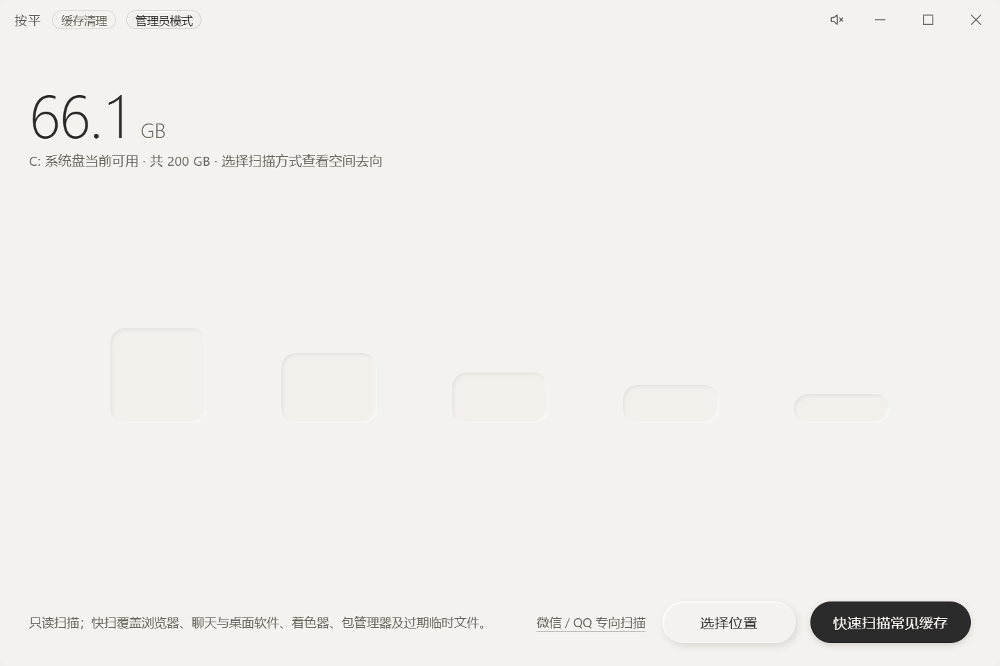
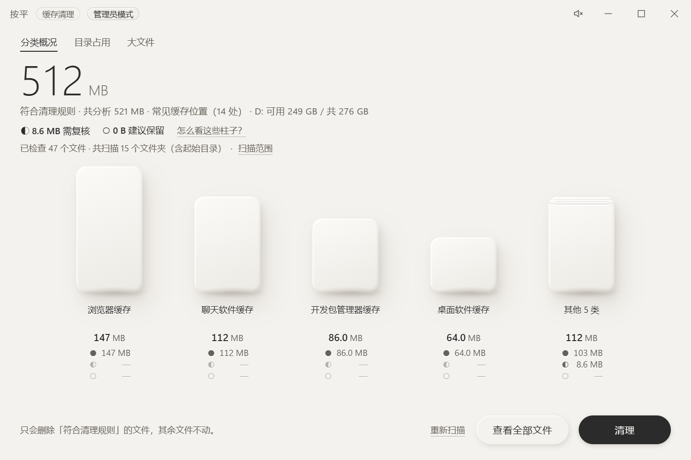
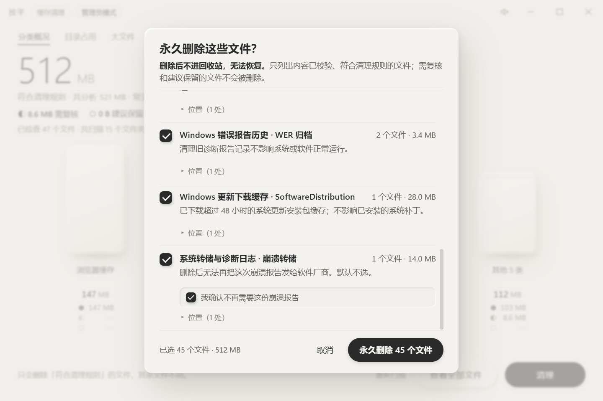
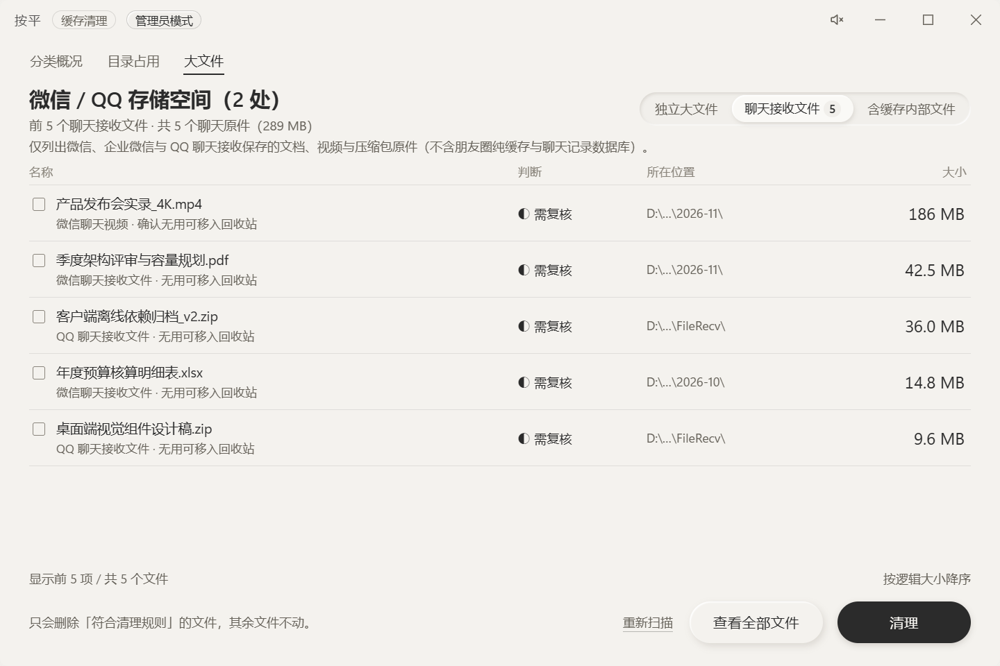

<div align="center">
  
  <h1>按平 · 看得懂依据的 Windows 空间分析与缓存清理工具</h1>
  <p>说人话的空间透视 · 文件头魔数与独占锁防误删底座 · 微信 / QQ 聊天存储细拆保护</p>
  <p>
    <a href="https://github.com/Feli999ovo/can-i-delete/releases"></a>
    <a href="https://github.com/Feli999ovo/can-i-delete/releases"></a>
    <a href="https://github.com/Feli999ovo/can-i-delete/releases"></a>
    <a href="LICENSE"></a>
  </p>
  <h3>
    <a href="https://github.com/Feli999ovo/can-i-delete/releases/latest">⬇ 下载最新 Windows 绿色便携版 v1.0.0 (ZIP)</a>
  </h3>
  <p><b>使用提醒：</b>下载后请先将 ZIP 完整解压到普通文件夹，再双击运行 <code>can-i-delete.exe</code>（切勿直接在压缩包预览窗口内双击）。</p>
</div>

---

## 实机界面一览

<table>
  <tr>
    <td width="50%" valign="top">
      
      <p align="center"><b>1. 打开即见系统盘实时容量</b><br/>直观展示系统盘当前可用空间，提供快速扫描、位置选择与微信 / QQ 专向直达入口。</p>
    </td>
    <td width="50%" valign="top">
      
      <p align="center"><b>2. 分类概况与三级判断纹理</b><br/>白瓷浮雕柱按线性比例呈现占用体积，清晰区分「符合清理规则 / 需复核 / 建议保留」。</p>
    </td>
  </tr>
  <tr>
    <td width="50%" valign="top">
      
      <p align="center"><b>3. 十组缓存清单与崩溃转储独立确认</b><br/>逐组列出文件数、体积与清理后果；崩溃转储默认不勾选，须二次勾选确认后才执行。</p>
    </td>
    <td width="50%" valign="top">
      
      <p align="center"><b>4. 微信 / QQ 聊天接收大文件专向透视</b><br/>剥离零碎缓存干扰，集中查看群聊收发的视频、PDF 与压缩包原件，按需移入系统回收站。</p>
    </td>
  </tr>
</table>

---

## 为什么做「按平」？（三大核心差异）

### 1. 说人话、不恐吓，把决定权还给你
许多清理工具习惯用“发现数万个垃圾危及系统”制造焦虑，却不告诉你删的到底是什么。按平对每一个分析到的文件都用通俗中文写明**「这是什么、删除会怎样、为什么这样判断」**：
- **`● 符合清理规则`**：位于受控缓存目录内且通过二进制内容校验的纯缓存，支持主页一键批量清理；
- **`◐ 需复核`**：下载安装包、办公文档或群聊接收原件等规则无法替你做主的文件，绝不混入批量清理，可在详情页定位核实或手动单文件**移入回收站**；
- **`○ 建议保留`**：系统核心组件、`Windows\Installer` 维护包、聊天记录数据库与运行锁文件，严格只读保护。

### 2. 文件头魔数 + 独占锁核验的零误删底座
按平绝不仅靠文件名或扩展名盲目删文件。点击「清理」批量永久删除受控缓存时，后端对每个文件执行双重硬核验：
- **正向二进制内容校验**：逐个核对 Chromium Simple Cache / Blockfile 魔数、npm SHA-512 内容摘要、`CMMM` 缩略图头、`DXBC` 着色器头、`V1MMWX` 小程序包头或 `MDMP` 流边界；哪怕把重要 PDF 或 Word 文档改名放进临时文件夹，也会被文件头守卫直接拦截；
- **同句柄身份与独占锁复核**：删除前以无共享模式打开目标句柄，在**同一个文件句柄**上核对磁盘卷序列号与文件索引（`VolumeSerial + FileIndex`）、逻辑大小及修改时间，防止扫描后文件被掉包（TOCTOU 防护）；正被运行中浏览器或软件占用的文件自动安全跳过。

### 3. 微信 / 企业微信 / QQ 跨盘细拆与聊天记录死锁保护
针对国内办公最高频的聊天软件空间膨胀痛点，按平自动跨盘定位默认位置或迁移至 D 盘等分区的 `WeChat Files`、`xwechat_files`、`WXWork`、`Tencent Files` / NTQQ 存储目录，做三轨精细拆分：
- **朋友圈与小程序纯缓存一键清（`TMP-CHATCACHE`）**：`Sns\Cache` 朋友圈图片视频缓存、`Applet` 小程序包与内置网页缓存经内容头校验后归入纯缓存清理；
- **`Msg\*.db` 聊天记录库死锁保护（`KEEP-CHATDB`）**：微信 `Msg\*.db` 与 QQ `nt_db` 数据库在规则层、安全策略层与回收引擎实施三重硬拦截，强制标为 `○ 建议保留`，严禁批量清理与单文件回收；
- **群聊接收大文件单独透视**：`FileStorage\File`、`Video`、`MsgAttach` 与 `FileRecv` 接收原件绝不自动删除，可在「大文件 → 聊天接收文件」胶囊下按体积排序查看，确认无用可手动移入 Windows 系统回收站（需要时随时从桌面回收站还原）。

---

## 十大受控缓存清理规则矩阵

主页批量「清理」仅处理以下十类位于受控缓存根目录内、且逐个通过正向内容或结构校验的文件（单一声明式真理源：`Rules/CacheRuleRegistry.cs`）：

| 规则编号 | 缓存分组 | 受控扫描位置 | 正向内容与边界校验 | 清理后果说明 |
| --- | --- | --- | --- | --- |
| `TMP-PKGCACHE` | 开发包管理器缓存 · npm / pip / NuGet / Yarn / pnpm / Go / uv | `%LOCALAPPDATA%` 下的 `npm-cache\_cacache\content-v2\sha512`、`pip\cache`、`NuGet\v3-cache`、`Yarn\Cache`、`pnpm-cache`、`go-build`、`uv\cache` | npm 校验内容 SHA-512 等于文件名；pip/NuGet/Yarn/pnpm/Go/uv 核对压缩包/JSON/编译产物头并拦截文档头 | 下次安装依赖或编译时联网自动重下重建；离线或私有源不可达时无法从本地安装 |
| `TMP-BROWSERCACHE` | 浏览器缓存 · Edge / Chrome / Firefox / Brave / Vivaldi / Opera | 各浏览器配置下的 `Cache\Cache_Data`、`Code Cache`、`GPUCache`、`DawnCache` 及 Firefox `cache2\entries`、`startupCache` | 校验 Chromium 缓存魔数、V8 字节码与 Firefox 缓存头；**硬排除 `Cookies`、`Login Data`、书签、历史与扩展数据** | 网页图片与脚本缓存会自动重新加载；不影响登录状态、密码与浏览记录 |
| `TMP-CHATCACHE` | 微信 / 企业微信 / QQ 纯缓存 | 自动跨盘定位的聊天存储下属 `Sns\Cache`、`Applet`、`XPlugin`、`xweb`、`CefCache`、`nt_temp` 纯缓存子目录 | 校验媒体缓存块或 `V1MMWX` 小程序包等缓存头；**三重硬排除 `Msg\*.db` 聊天数据库与聊天接收原件** | 再次翻看旧朋友圈或打开小程序时按需重新加载；绝不触碰聊天记录与接收文件 |
| `TMP-APPCACHE` | 桌面软件与组件缓存 · VS Code / Cursor / WebView2 | 受控桌面软件及 `EBWebView` 的 `Cache_Data` / `Code Cache` / `GPUCache` / `DawnCache`，以及 `Code` / `Cursor` 的 `CachedData`、`CachedExtensionVsiXs` | 校验 Chromium 缓存魔数、V8 编译缓存或 VSIX 包头；排除 `settings.json`、`Local Storage`、`state.vscdb` 等个人配置 | 下次启动对应桌面软件时自动重建缓存；不影响登录凭据、插件运行与个人设置 |
| `TMP-THUMBCACHE` | 缩略图与图标缓存 | `%LOCALAPPDATA%\Microsoft\Windows\Explorer\` 下的 `thumbcache_*.db`、`iconcache_*.db` | 校验 `CMMM` 文件头、版本号与条目偏移边界；索引文件 `*_idx.db` 不删 | 资源管理器自动重新生成，下次打开图片较多的文件夹时预览稍慢；占用中的文件自动跳过 |
| `TMP-SHADERCACHE` | 图形与着色器缓存 · DirectX / NVIDIA / AMD / Intel | `%LOCALAPPDATA%` 与 `%APPDATA%` 下的 `D3DSCache`、`DXCache`、`GLCache`、`VkCache`、`ShaderCache`、`nv_cache` | 校验 `DXBC` 及显卡着色器二进制帧头与非空结构；锁文件 `*.lock` 与文档头不删 | 游戏或 3D 图形程序下次启动时自动重新编译着色器，首次加载可能稍慢 |
| `TMP-SYSTEMP` | 系统与软件临时文件 · 分级冷却 | `%LOCALAPPDATA%\Temp\`（管理员模式下含 `%WINDIR%\Temp\`）下的 `.tmp`、`.temp`、`.log`、`.etl` 及专用安装解包临时目录 | 普通临时项须满 **24 小时**未修改，安装解包残留须满 **48 小时**；排除 Office 草稿前缀（`~$` / `~df`）与压缩软件预览目录 | 超过冷却期且未占用的过期临时残留被移除；近期文件与正在使用的文件自动跳过 |
| `TMP-WER` | Windows 错误报告历史 · WER 归档 | `%LOCALAPPDATA%` 与 `%PROGRAMDATA%` 下 `Microsoft\Windows\WER\ReportArchive`、`ReportQueue` | 校验 UTF-16/UTF-8 `Report.wer` 键值头、`MSCF` 诊断包头或用户态 `MDMP` 头；内核转储不删 | 移除历史程序异常诊断归档，不影响系统与软件正常运行 |
| `TMP-WINUPDATE` | Windows 更新下载缓存 · SoftwareDistribution | `%WINDIR%\SoftwareDistribution\Download\`（**严禁触碰 `DataStore` 更新历史数据库**） | 修改时间须满 **48 小时**，且通过 `MSCF`（CAB）、`MSWIM`（ESD）或更新清单结构校验 | 移除超过 48 小时的旧系统补丁下载副本，不影响已安装的更新；近期补丁自动跳过 |
| `TMP-CRASHDUMP` | 系统转储与诊断日志 · 崩溃转储 | `%LOCALAPPDATA%\CrashDumps\` | 校验 `MDMP` 文件头、流目录及每个数据流边界；内核转储（`PAGEDU64`）不删；**默认不勾选，须单独勾选确认** | **无法重新生成**：删除后无法再把这次崩溃转储发给软件厂商排查问题；不影响程序运行 |

> **审计边界承诺**：批量「清理」为**永久删除**，不经过系统回收站；每次批量清理或单文件移入回收站前后均强制写入本地审计日志 `data\delete-log.txt`（`Intent -> Action -> Outcome`），日志不可写时整批拒绝执行。

---

## 运行环境与纯净便携 `data\` 说明

- **系统环境要求**：Windows 10 / Windows 11 x64，系统自带 **.NET Framework 4.8** 及 **Microsoft Edge WebView2 Runtime**（Windows 10 新版与 Windows 11 默认内置；若缺失启动时会弹出中文指引并安全退出）。
- **便携解压结构**：请保持解压目录完整，不要单独拖出 `can-i-delete.exe` 运行：

```text
按平-v1.0.0-win-x64-portable/
├─ can-i-delete.exe        # 主程序（内嵌多尺寸高清图标）
├─ WebView2Loader.dll      # WebView2 原生加载器
├─ LICENSE                 # MIT 开源许可证
├─ README.md               # 产品使用说明
├─ lib/                    # WebView2 托管互操作组件
└─ ui/                     # 白瓷浮雕前端界面与合成提示音资源
```

- **零注册表垃圾的便携 `data\` 隔离**：首次运行后，界面缓存、提示音开关偏好与删除审计日志（`data\delete-log.txt`，超过 5 MB 且无未决记录时自动轮转为单份 `.old.txt`）全部存放在 `can-i-delete.exe` 同级的 `data\` 文件夹内，不向系统 `AppData` 或注册表散落残留；删除整个程序文件夹即可彻底卸载。
- **默认普通权限，按需管理员提权**：打开程序默认不弹 UAC 窗口；仅当检测到系统盘存在需要管理员权限读取的 `SoftwareDistribution\Download` 或 `Windows\Temp` 时，界面才会提供温和的按需提权重启入口。

---

## 首次运行 SmartScreen 提示与 SHA-256 校验指引

由于「按平」为免费开源独立工具，当前发行版暂未购买商业代码签名证书（`Authenticode: NotSigned`）。首次在 Windows 10 / 11 上双击 `can-i-delete.exe` 时，可能会看到蓝色 **“Windows 已保护你的电脑（Microsoft Defender SmartScreen）”** 提示窗：

1. **先核对官方 SHA-256 校验值**：在下载目录打开 PowerShell，运行以下命令并核对输出哈希与 [Releases 发布页](https://github.com/Feli999ovo/can-i-delete/releases/latest) 中的 `SHA256SUMS.txt` 完全一致：
   ```powershell
   Get-FileHash .\按平-v1.0.0-win-x64-portable.zip -Algorithm SHA256
   ```
2. **确认校验一致后启动**：在蓝色提示窗点击 **「更多信息」** → 点击底部 **「仍要运行」**，后续在同一目录再次打开即不再弹窗。

---

## 四模块源码架构

```text
can-i-delete/
├─ Host/      宿主窗体、原生多尺寸图标、便携单实例唤醒与 UAC 交接、前后端桥接及本地数据目录（Program / AnPingForm / AnPingBridge / AppDataPaths）
├─ Engine/    多根并发扫描、PathPool 前缀驻留池、目录汇总、句柄级永久删除与空壳子目录收尾、单文件回收站引擎、5MB 审计日志安全轮转、Restart Manager 占用探测
├─ Rules/     CacheRuleRegistry 十大规则单一真理源、ChatStorageLocator 跨盘聊天存储寻址、路径与二进制魔数证据校验、安全策略与人话解释
└─ ui/        白瓷浮雕前端界面（index.html + styles.css + app.js）与合成提示音模块（anping-audio.js）
```

## 从源码构建及 259+ 项自动化安全回归测试

- **零外部构建器编译**：在源码根目录运行 `cmd /c build.bat`，直接调用 Windows 内置 `.NET Framework 4.x csc.exe`（严格遵循 C# 5 `-langversion:5 -warnaserror` 零警告标准），编译产出内嵌多尺寸原生图标的 `can-i-delete.exe`（同时兼容 `can-i-delete.csproj`）。
- **259+ 项隔离沙盒回归测试**：
  1. 运行 `cmd /c tests\run-tests.bat`：依次执行 `LegacyRepro`（17 项历史防误删回归）、`SelfTest`（Group A–E 共 240+ 项覆盖十大规则正反例、重解析点拦截、TOCTOU 句柄防掉包、微信数据库硬保护、单实例互斥与日志轮转）以及 `AnPingExplanationTest` 人话解释测试；
  2. 运行 `tests\*.cjs` 全部 10 个前端状态机、几何规范、提示音波形与便携数据目录契约测试。
  所有自动化测试全程在 `%TEMP%` 或临时隔离沙盒内运行，对本机真实用户文件与系统设置零副作用。

---

## 开源许可证

本项目基于 [MIT License](LICENSE) 许可发布，维护者：[Feli999ovo](https://github.com/Feli999ovo)。
